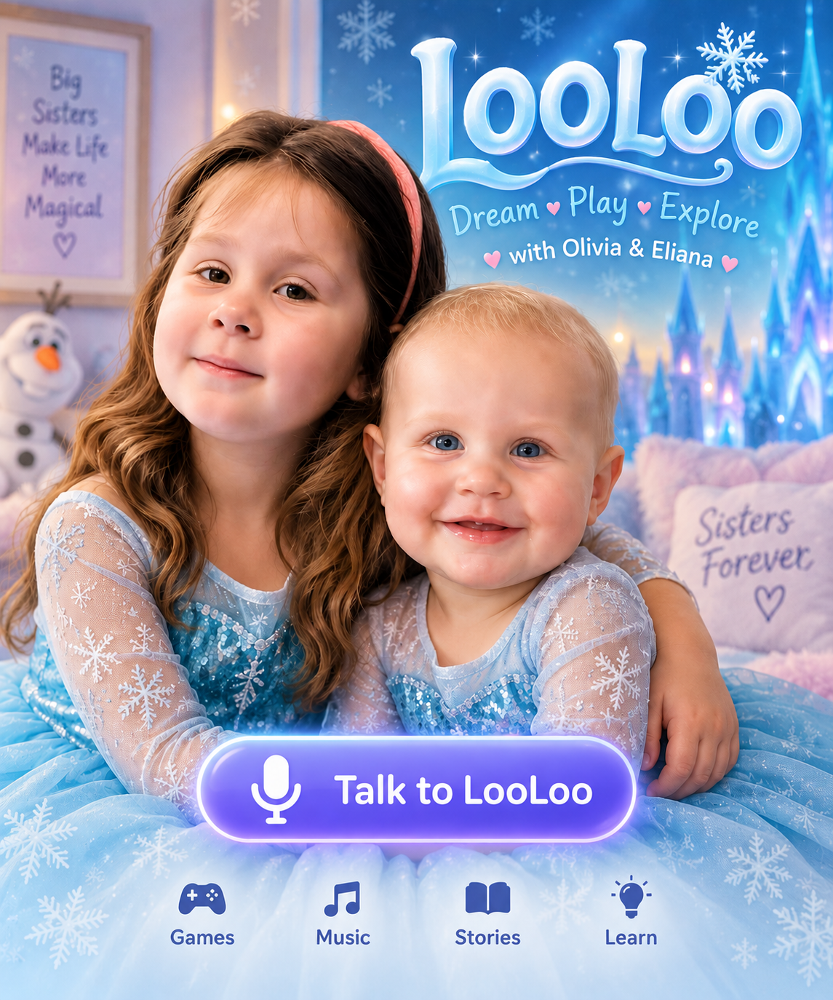
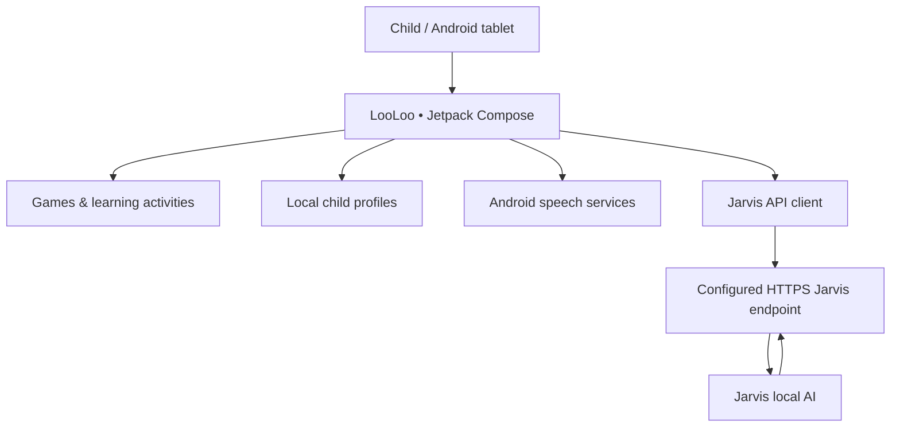

<div align="center">

# 🌈 LooLoo

**A little imagination. A lot of learning. A companion built with love.**




*An Android learning and play companion, inspired by my grandchildren and built by Papa.*

</div>

## 💜 Why I Built LooLoo

LooLoo began as a personal project to give my grandchildren a friendly, interactive way to explore technology, ask questions, hear stories, play games and learn at their own pace.

What started as a voice companion has grown into a collection of educational activities, creative tools and games, with a connection to my local AI assistant, [Jarvis](https://github.com/mnahtygal/Jarvis).

The goal is to make technology feel approachable, imaginative and fun while keeping adults involved in how AI is used.

## ✨ Explore LooLoo

| 📚 Learn | 🎮 Play | 🎨 Create |
| --- | --- | --- |
| ABC Adventure | Tic-tac-toe | Coloring pictures |
| Speak & Spell | Memory Match | Piano |
| Counting | Jigsaw puzzles | Drums |
| Math | Billiards | Letter tracing |
| Shapes Adventure | Animal sounds | Story time |

### 🎙️ Voice & AI

- Android speech recognition and text-to-speech.
- Voice-driven navigation to supported games and activities.
- A conversational interface connected to a configured Jarvis backend.
- Individual child profiles and profile-based experience policies.
- Launch integration for supported installed children's media apps.

### 🧩 Learning through play

Activities cover early literacy, numeracy, pattern recognition, memory, creativity and fine motor practice. Letter tracing gives children another way to practice writing using touch or a compatible stylus.

## 🖼️ App Gallery

The artwork at the top of this README is the existing LooLoo home-screen artwork from the Android project, not an actual device screenshot.

A gallery of real tablet screenshots is planned for the home screen, learning activities, games, letter tracing and story time. Screenshots will be reviewed to avoid exposing personal information before publication.

## 🧠 How It Works



LooLoo is a native Android application. Its games and learning screens are implemented in the app, while AI conversations can use a separately configured Jarvis server. In my home lab, Jarvis runs on NVIDIA Jetson AGX Thor.

Android speech services may depend on the device's installed speech provider, language packs and network availability. A local Jarvis backend does not guarantee that all Android services operate offline.

## 🛠️ Technology Stack

| Component | Technology |
| --- | --- |
| Language | Kotlin |
| Interface | Jetpack Compose, Material 3 |
| Minimum Android version | Android 8.0 (API 26) |
| Build / target SDK | API 37, as configured on main |
| Local profiles | SharedPreferences |
| Voice | Android SpeechRecognizer and TextToSpeech |
| AI backend | Jarvis |
| Testing | JUnit and Android instrumented / Compose tests |
| Development | Android Studio, Gradle, GitHub |

## 🚀 Getting Started

This is an active development project, not a production-ready children's service.

1. Clone the repository:
   ```bash
   git clone https://github.com/mnahtygal/Olivia-Looi.git
   cd Olivia-Looi
   ```
2. Open the project in Android Studio with the SDK and JDK required by the project's Gradle configuration.
3. Configure a compatible emulator or Android device.
4. For Jarvis connectivity, configure a reachable HTTPS endpoint and an authorized handheld token through your local development environment.
5. Build and install the debug application.

```bash
./gradlew assembleDebug
./gradlew installDebug
```

### Jarvis configuration

The build accepts these environment variables, or their corresponding entries in your untracked local.properties file:

| Environment variable | Local property |
| --- | --- |
| JARVIS_BASE_URL | jarvis.baseUrl |
| JARVIS_HANDHELD_TOKEN | jarvis.handheldToken |

Use your own server address and restricted credentials. Never commit credentials or distribute a debug APK containing private tokens. Build-time values embedded in an APK are not a secure secret store.

See [Jarvis](https://github.com/mnahtygal/Jarvis) for the backend project.

### Running tests

```bash
./gradlew testDebugUnitTest
./gradlew connectedDebugAndroidTest
```

The second command requires a connected compatible device or emulator.

## 🔒 Privacy & Responsible AI

LooLoo is designed as a family-supervised learning project. Child profiles and the local-first AI architecture are important foundations, but do not by themselves establish child safety, privacy compliance or complete content filtering.

- Adult supervision is recommended for AI conversations and external media applications.
- Review microphone permissions, speech-provider behavior and network configuration.
- Keep credentials, family information and personal screenshots out of public commits.
- Review AI responses and access controls before deploying outside the development environment.

## 🗺️ Development Roadmap

- Continue improving conversational reliability and Jarvis connectivity.
- Expand educational activities and handwriting practice.
- Improve tablet usability, accessibility and age-appropriate experiences.
- Validate away-from-home operation and network failure handling.
- Add a public screenshot gallery and installation documentation.
- Explore a reusable family-friendly edition with configurable profiles.

## 👨‍💻 About the Developer

I'm [Marty Nahtygal](https://github.com/mnahtygal), a software and data engineer with more than 42 years in IT, a local AI enthusiast, maker and proud Papa.

LooLoo is part of my personal technology portfolio alongside Jarvis, Thor City and CoinScope.

---

<div align="center">

**Built by Papa. Inspired by family. Made for curious little minds. 💜**

</div>
